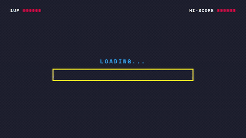
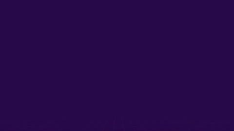

<div align="center">

# /intro

### A one-of-a-kind YouTube intro for your channel, designed by Claude Code. One command.

[](LICENSE)
[](https://claude.com/claude-code)
[](https://github.com/heygen-com/hyperframes)
[](CONTRIBUTING.md)

<!-- This GIF was generated by /intro itself -->


</div>

---

Type `/intro`. Claude doesn't fill in a template: it learns what your channel is about, invents a **concept** that could only be yours, writes the motion graphics and the soundtrack from scratch, renders an MP4, then **looks at its own frames** and fixes what's wrong.

```text
> /intro "Midnight Baker" --vibe "cozy night-shift sourdough, warm, steam"
✔ concept: steam condenses into the name like writing on a fogged bakery window
✔ composition  ✔ soundtrack  ✔ check  ✔ rendered intro-output/intro.mp4 (1920x1080, 5.0s)
```

Same command, different channel, different intro:

| | |
|---|---|
| **Midnight Baker** (cozy baking): steam drifts up and the name condenses out of it, a bell rings<br> | **Pixel Quest** (retro gaming): fake boot loader, frame-stepped letter drop, coin chime<br> |
| **Orbit Lab** (space science): a moon slides across the sun, totality, a hush, then the name<br> | _Yours: run `/intro` with your channel's vibe_ |

All three were designed from scratch by following the skill (Orbit Lab was made by a fresh agent that only had the skill's instructions, as a test). Their source (`concept.md`, `audio.json`, composition) is in [`examples/custom/`](examples/custom/).

## Install

**Claude Code (plugin)**

```bash
/plugin marketplace add mahmoud-emad/intro-maker
/plugin install intro-maker@intro-maker
```

**Any agent via the `skills` CLI**

```bash
npx skills add mahmoud-emad/intro-maker
```

**Manual**

```bash
git clone https://github.com/mahmoud-emad/intro-maker
cp -r intro-maker/skills/intro ~/.claude/skills/intro
```

### Requirements

- Node.js 22+
- FFmpeg on your `PATH`
- Network access on first run: [Hyperframes](https://github.com/heygen-com/hyperframes) is fetched with `npx` and downloads headless Chrome (`npx hyperframes doctor` to check; the Docker / Kokoro / MusicGen warnings are optional)

## Use

```text
/intro "Code With Sam" --vibe "calm, minimal, a chef's-knife precision"
/intro "Orbit Lab" --vibe "space science, awe" --tagline "Learn the universe"
/intro                                   # infer name + topic from the project in this folder
/intro "Shorts Daily" --format vertical --duration 4
/intro "Acme" --logo ./logo.svg --accent "#ff5a1f"
/intro "Code With Sam" --style neon      # optional: skip the design and use a quick preset
```

| Flag | Meaning | Default |
|---|---|---|
| first arg / `--name` | channel text (≤ 24 chars) | inferred |
| `--vibe "..."` | free-text creative direction | inferred from the channel's topic |
| `--tagline` | line under the name (≤ 40 chars) | none |
| `--duration` | 3-8 s | 5 |
| `--format` | `landscape` `vertical` `square` | `landscape` |
| `--logo`, `--accent` | use your logo / force a colour | free |
| `--no-music` `--no-sfx` | drop soundtrack layers | audio on |
| `--style` | `terminal` `neon` `minimal` `glitch` `retro` `cinematic`: skips design, builds a preset | none (creative mode) |

## Quick presets (optional)

Need one in 60 seconds with no design step? `--style` builds one of six ready-made looks. They're shortcuts; creative mode is the product.

| | |
|---|---|
| **terminal**: typed command, green glow. Built for dev channels<br> | **neon**: flickering tubes, chromatic glow<br> |
| **minimal**: whitespace, one clean line draw<br> | **glitch**: scanlines, RGB split, snap to clean<br> |
| **retro**: synthwave grid and sunset<br> | **cinematic**: slow push-in, light leak, serif<br> |

MP4s and the exact command for each preset live in [`examples/`](examples/).

## How it works

1. **Brief**: reads your folder (README, package.json, git remote, brand files) and your `--vibe` to understand the channel
2. **Concept**: invents three different ideas, picks one, writes `concept.md` (metaphor, palette, type, signature move, hit moment, sound) and a storyboard. An **originality check** forces it to differ from the presets and the examples
3. **Compose**: scaffolds a [Hyperframes](https://github.com/heygen-com/hyperframes) project and authors the HTML/CSS/GSAP composition by hand, plus a **cue sheet** (`audio.json`) that FFmpeg turns into a custom soundtrack (pads, bells, chiptune, risers, impacts, noise swells...)
4. **Render & review**: `hyperframes check` gate, render, spec verification (resolution, duration, audio), then Claude **looks at six frames** and iterates up to 3 times
5. **Deliver**: `intro.mp4`, poster, `share-copy.txt`, and a short explanation of the concept

Details live in [`skills/intro/`](skills/intro/SKILL.md): `references/concepts.md` (idea fuel), `motion-cookbook.md` (techniques and checker rules), `audio.md` (cue-sheet format).

## Repo layout

```
skills/intro/        the skill: SKILL.md, references/, scripts/ (new, audio, render, presets)
.claude-plugin/      plugin + marketplace manifests
.claude/skills/      symlink for in-repo discovery
.agents/skills/      symlink for other agents
examples/            one rendered intro per preset + examples/custom (bespoke, with concept + source)
docs/                landing page (GitHub Pages) + demo assets
test/                smoke tests
```

## Develop & test

The generator is plain Node (no dependencies): `skills/intro/scripts/build.mjs`.

```bash
npm test                 # presets, formats, scaffold, audio cue sheets, both bespoke examples, input validation
npm run test:render      # same, but also renders every MP4
node skills/intro/scripts/build.mjs --name "My Channel" --style glitch --render --out ./out   # preset
node skills/intro/scripts/new.mjs --out ./mine --duration 5                                   # blank composition for a bespoke intro
node skills/intro/scripts/audio.mjs ./mine/audio.json                                         # synthesize a cue sheet
node skills/intro/scripts/render.mjs ./mine --snapshots                                       # check + render + verify
```

## Contributing

Concepts (add a bespoke example under `examples/custom/`), cookbook techniques, audio layers, and formats are the best PRs. See [CONTRIBUTING.md](CONTRIBUTING.md).

## Credits

Rendering by [Hyperframes](https://github.com/heygen-com/hyperframes). Inspired by [latent-spaces/brag](https://github.com/latent-spaces/brag). Audio is synthesized with FFmpeg, so there is nothing to attribute ([details](skills/intro/references/audio.md)).

## Star history

[](https://star-history.com/#mahmoud-emad/intro-maker&Date)

## License

[MIT](LICENSE)
